<table>
<tr>
<td width="45%" align="center">

</td>
<td width="55%" align="left">

 
I build clean, maintainable, and scalable backend solutions with Java, focusing on solid architecture and software quality. Plus a little kick of AI here and there.

 

</td>
</tr>
</table>

## Contact.ME

If you'd like to chat about technology, projects, or opportunities, feel free to reach out!

