<table>
<tr>

<td width="45%" align="center">

  

</td>

<td width="55%" align="left">

I'm a Computer Science student with a background in Computer Networks and a strong
interest in backend software development. I enjoy building clean, maintainable,
and scalable solutions with Java, while focusing on object-oriented programming,
good architecture, code quality, and continuous improvement.

Currently, I'm improving my skills in Java backend development, REST API design,
backend architecture, documentation, testing, and software quality. I'm also
expanding my knowledge of Spring Boot and related tools used to build reliable
and well-structured applications.

I also have experience teaching Python, working collaboratively, solving problems,
and adapting to new technologies. I'm interested in understanding real-world
needs and transforming them into simple, reliable, and meaningful software
solutions.

  
  

<h2>Stack</h2>

7 tools I reach for

  
  
  
  

  
  
  
  

</td>

</tr>
</table>

<h2>Contact.ME</h2>

If you'd like to chat about technology, projects, or opportunities, feel free to reach out!

